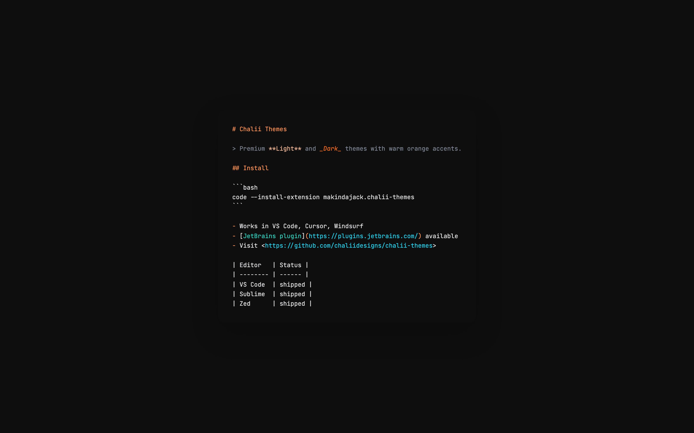

<p align="center">
  
</p>

<h1 align="center">📝 Chalii Themes — Obsidian</h1>

<p align="center">
  A single CSS theme for Obsidian with warm orange accents that auto-switches between Light and Dark with the app's appearance setting.<br>
  The Obsidian port of the <a href="https://github.com/chaliidesigns/chalii-themes">Chalii Themes</a> family, generated from one shared palette.
</p>

<p align="center">
  <a href="#-features">✨ Features</a> •
  <a href="#-quick-start">🚀 Quick Start</a> •
  <a href="#-structure">🏗️ Structure</a> •
  <a href="#-how-it-is-built">🔧 How It Is Built</a> •
  <a href="https://github.com/chaliidesigns/chalii-themes">🧩 Source Repo</a>
</p>

<p align="center">
  
  
  
  
  
</p>

---

## 🌟 Highlights

- 🌗 **One file, both modes** — `.theme-light` and `.theme-dark` blocks follow **Settings → Appearance → Base color scheme** (or your OS when set to *Adapt to system*)
- 🟠 **Chalii palette** — orange accents (`#e65800` light / `#ff711a` dark), purple types, teal strings, deep `#0e0e0f` dark background
- 🧩 **Native variables only** — overrides Obsidian's own `--background-*`, `--text-*`, `--interactive-*`, `--link-*` and `--code-*` custom properties, so plugins and core UI pick the colours up automatically
- 🔁 **Generated from the source palette** — never hand-edited; stays in sync with the VS Code, JetBrains, Sublime, Zed and terminal ports

## ✨ Features

- ~80 CSS variables per mode covering backgrounds, borders, hover/active states, accent, text tiers (normal / muted / faint), links (internal, external, unresolved) and selection
- Code-block syntax colours (`--code-keyword`, `--code-string`, `--code-function`, `--code-comment`, …) plus CodeMirror span rules for the editor
- Success / error modifiers for callouts and form validation
- No external fonts, images or `@import`s — a single 6 KB stylesheet

## 🚀 Quick Start

### Manual install

1. Create the directory `<vault>/.obsidian/themes/Chalii/`.
2. Copy `theme.css` and `manifest.json` into it.
3. Open **Settings → Appearance → Themes** and pick **Chalii**.
4. Switch **Base color scheme** to Light, Dark or *Adapt to system* — the theme follows.

```bash
# from a clone of this repo
VAULT=/path/to/your/vault
mkdir -p "$VAULT/.obsidian/themes/Chalii"
cp theme.css manifest.json "$VAULT/.obsidian/themes/Chalii/"
```

## 🏗️ Structure

```
chalii-obsidian/
├── theme.css        # Generated theme (.theme-light + .theme-dark + code spans)
├── manifest.json    # Obsidian theme manifest (name, version, minAppVersion)
├── screenshot.png   # Preview
├── LICENSE          # MIT
└── README.md
```

## 🔧 How It Is Built

`theme.css` and `manifest.json` are emitted by `build/obsidian.mjs` in [chalii-themes](https://github.com/chaliidesigns/chalii-themes) from `source/palette.json`:

```bash
# in chaliidesigns/chalii-themes
npm run build:obsidian   # writes ports/obsidian/theme.css + manifest.json
```

**Do not edit files here directly** — open issues and pull requests against [chalii-themes](https://github.com/chaliidesigns/chalii-themes/issues), then sync the regenerated output into this repo.

## 📄 License

[MIT](LICENSE) © Jackson Makinda

## 👤 Author

**Chalii Designs** — design & engineering studio by Jackson Makinda — [makindajackson.com](https://makindajackson.com)

- 📧 Email: me@makindajackson.com
- 💼 LinkedIn: [Jackson Makinda](https://linkedin.com/in/makindajack)
- 🎨 Dribbble: [@makindajack](https://dribbble.com/makindajack)
- 🐦 Twitter: [@makindajack](https://twitter.com/makindajack)

Part of the **Chalii** design ecosystem — [Themes](https://github.com/chaliidesigns/chalii-themes) • [Icons](https://github.com/chaliidesigns/chalii-icons) • [Sublime](https://github.com/chaliidesigns/chalii-sublime) • [Zed](https://github.com/chaliidesigns/chalii-zed) • [Spicetify](https://github.com/chaliidesigns/chalii-spicetify)

---

Built with ❤️ in Dar es Salaam, Tanzania 🇹🇿
